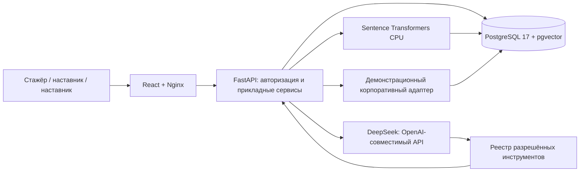

> Обновление: в приложении две роли — стажёр и наставник. Наставник управляет планом, целями и OKR только закреплённых стажёров, проверяет задачи и согласует заявки всех ресурсов. Старые аккаунты руководителей сохраняются с ролью наставника; новые такие аккаунты seed не создаёт.
> Задачи выполняются кнопками «Приступить» → «Завершить». Для проверки наставником кнопка открывает отправку результата, для теста — мини-тест, для задачи отправки заявки — её оформление. Только явно настроенное условие `request` завершает задачу после создания заявки, не после подготовки черновика.

# AI-buddy — персональный ИИ-наставник стажёра

Прототип для «Авито Hack&Change 2026». Помогает согласовать ожидания наставника, вести персональный план, выполнять задачи, подтверждать результаты и оформлять корпоративные заявки. Все персональные состояния сохраняются в PostgreSQL. Продуктовая польза пока является гипотезой, а не измеренным результатом пилота.

## Что реализовано

- Авторизация через JWT в HttpOnly cookie, Argon2, проверка Origin и заголовка против CSRF.
- Стажёр: главная, «Моя адаптация» (`/onboarding`), согласование плана, комментарии, цели, критерии, сроки, задачи, прогресс и следующие шаги.
- Наставник команды: выбор стажёра, создание и редактирование черновика, назначение задач, связь с целями, отправка на согласование, новая версия, подтверждение критериев цели, командные OKR.
- Наставник: закреплённые стажёры, результаты на проверку, подтверждение или возврат с замечаниями, ответы на обращения. Наставник также редактирует ожидания через новую версию согласованного плана.
- Способы подтверждения задач: автоматически после отправки заявки, самостоятельно; проверка наставником; мини-тест. Сохраняются автор, результат, время и история повторных проверок.
- Три синтетических мини-теста по 3 вопроса: Code Review, Git workflow, доступы. Порог 2/3 хранится на сервере. Ответы проверяются по ключу PostgreSQL; браузер не получает ключ до попытки. Повторные попытки сохраняются, ошибки объясняются.
- ИИ-чат с историей, персональным контекстом из PostgreSQL и безопасными инструментами чтения плана, целей, задач, прогресса, следующих шагов и OKR.
- RAG: Sentence Transformers → `intfloat/multilingual-e5-small` на CPU → PostgreSQL/pgvector → DeepSeek. Статические инструкции отделены от актуальных персональных данных. Для известного противоречия Code Review показываются оба источника.
- Заявки Jira/Confluence/GitLab: черновик → явное подтверждение → запись с номером → решение назначенного согласующего. Повторное подтверждение того же черновика не создаёт дубль. Заявку можно связать с собственной задачей, включая запуск формы из задачи.
- Обзор реальных показателей: задачи на проверке, просрочки, блокировки, достигнутые цели; заявки по статусам и среднее время решения; число ответов ассистента и доля ответов с источниками.
- Светлая/тёмная темы, существующая адаптивная оболочка, состояния загрузки и ошибок.

План согласуют люди: наставник отправляет предложение, стажёр соглашается. ИИ не утверждает цели, не выставляет итоговую оценку стажировки и не принимает кадровые решения. Выполненные задачи не означают автоматического достижения цели: наставник отдельно проверяет критерии и прикладывает подтверждение.

## Архитектура



Backend: Python 3.14, FastAPI, SQLAlchemy, Alembic, Pydantic Settings, Pytest. Frontend: React, TypeScript, Vite, React Router, TanStack Query, CSS. Docker запускает БД, backend с миграциями/seed/индексацией и frontend с Nginx. Отдельно устанавливать Python и Node.js проверяющему не требуется.

## LLM и ключ организаторов

Внешние LLM разрешены условиями задачи. Основной провайдер — **DeepSeek**, модель по умолчанию **`deepseek-flash`**, базовый адрес **`https://api.deepseek.com`**. На 15.11.2026 идентификатор и Tool Calling сверены с [официальным Chat Completions API](https://api-docs.deepseek.com/api/create-chat-completion/) и [руководством Tool Calls](https://api-docs.deepseek.com/guides/tool_calls/). Платный smoke-тест не запускался.

Организаторы подставляют собственный ключ в корневой `.env`, исходный код менять не нужно:

```env
LLM_API_KEY=ваш-ключ
LLM_BASE_URL=https://api.deepseek.com
LLM_MODEL=deepseek-flash
```

Приоритет: непустой `LLM_API_KEY` → `DEEPSEEK_API_KEY`; непустой `LLM_MODEL` → `DEEPSEEK_MODEL` → `deepseek-flash`. `LLM_BASE_URL` задаётся независимо. `.env` исключён из Git. Ключ доступен только backend, не помещайте его в `VITE_*`, запросы браузера или журнал.

Для другого OpenAI-совместимого провайдера поменяйте три `LLM_*`. Нужны Chat Completions и function Tool Calling; совместимость с произвольной LLM не гарантируется. DeepSeek-параметр `thinking` передаётся только для адреса DeepSeek. Ошибка формата инструментов/провайдера возвращается понятным сообщением без тела ответа провайдера. При отсутствии ключа личный кабинет и планы доступны, чат возвращает сообщение о необходимости настройки LLM. Автоматические тесты используют mock LLM и не расходуют баланс.

## Запуск Ubuntu / Docker

```bash
cp .env.example .env
# Отредактируйте .env: пароль PostgreSQL, DEMO_PASSWORD (>=12 символов), JWT_SECRET, LLM_API_KEY.
# Пример генерации JWT_SECRET без установки Python:
openssl rand -hex 48
sudo docker compose up --build -d
sudo docker compose ps
```

Если Docker доступен без sudo:

```bash
docker compose up --build -d
```

Откройте `http://localhost:8080`. Для локального HTTP используйте `COOKIE_SECURE=false` и добавьте `http://localhost:8080` в `ALLOWED_ORIGINS` (уже есть в примере). В `POSTGRES_HOST` для локальной разработки указывается `127.0.0.1`; контейнер backend переопределяет его на `db`. Внутренний API не публикуется отдельным портом.

Первый запуск скачивает CPU-модель и индексирует инструкции, поэтому может занять несколько минут и требует доступа к PyPI, CPU-репозиторию PyTorch и Hugging Face. Модель сохраняется в `embedding_cache`. Миграции применяются автоматически. Идемпотентный seed не меняет существующие пароли и не сбрасывает прогресс. Не удаляйте volume `postgres_data`; команда `docker compose down -v` для этого проекта не нужна.

При повторном запуске:

```bash
sudo docker compose up --build -d
sudo docker compose logs --tail=50 backend
```

Docker-сборка и запуск PostgreSQL 17 в текущем окружении **не проверены**: нет доступа к Docker socket и отсутствует sudo без пароля. Миграции и интеграционные сценарии проверены на отдельном временном PostgreSQL 18.6 + pgvector 0.8.1, а не на рабочей БД. Подробности: [отчёт проверки](docs/verification-iteration4.md).

## Переменные окружения

| Переменные | Назначение |
| --- | --- |
| `POSTGRES_USER`, `POSTGRES_PASSWORD`, `POSTGRES_DB`, `POSTGRES_HOST`, `POSTGRES_PORT` | Подключение PostgreSQL |
| `JWT_SECRET` | Секрет подписи, минимум 32 символа |
| `DEMO_PASSWORD` | Первичный пароль создаваемых demo-аккаунтов, минимум 12 символов |
| `ALLOWED_ORIGINS` | JSON-массив разрешённых адресов frontend |
| `COOKIE_SECURE`, `SESSION_MINUTES` | HTTPS cookie и срок сессии |
| `LLM_API_KEY`, `LLM_BASE_URL`, `LLM_MODEL` | Ключ, endpoint и модель LLM |
| `DEEPSEEK_API_KEY`, `DEEPSEEK_MODEL` | Совместимость прежней конфигурации |
| `LLM_MAX_TOKENS`, `LLM_TIMEOUT_SECONDS`, `CHAT_DAILY_LIMIT` | Ограничения ответа, времени и числа попыток |
| `CHAT_MAX_MESSAGE_CHARS`, `CHAT_HISTORY_MESSAGES`, `CHAT_HISTORY_CHARS` | Ограничения входа и истории |
| `EMBEDDING_MODEL`, `EMBEDDING_CACHE_DIR`, `EMBEDDING_LOCAL_ONLY` | CPU embedding-модель и её кэш |
| `RAG_TOP_K`, `RAG_MIN_SCORE`, `RAG_CONTEXT_CHARS` | Поиск; текущий рекомендуемый порог `0.824128` |

Серверные feature flags, MCP-сервер, ИИ-крон и закрытые инструменты Авито не являются зависимостями. Реальные корпоративные сервисы не используются.

## Демонстрационные аккаунты

Все записи синтетические, команда — `Backend · Demo`. Пароль новых аккаунтов берётся из `DEMO_PASSWORD`. Для существующих остаётся ранее установленный пароль. Ранее созданный `manager@ai-buddy.example` также сохраняет пароль и входит как наставник; доступ определяется назначением стажёров.

| Аккаунт | Назначение |
| --- | --- |
| `mentor@ai-buddy.example` | Назначенный наставник, проверка результатов и обращения |
| `intern@ai-buddy.example` | Существующий профиль предыдущих итераций; прогресс сохраняется |
| `intern-new@ai-buddy.example` | Новый стажёр без предзаполненного плана, полный сценарий с нуля |
| `intern-ready@ai-buddy.example` | Подготовленный обзор: 3 цели, 10 задач, согласованный синтетический план, результат на проверке и блокировка |

Заранее согласованный профиль явно помечен как синтетическое состояние seed. Он не выдаёт фиктивные действия за действия пользователей. Для основного показа используйте `intern-new`.

## Корпоративная демополитика

Разрешены Jira, Confluence и GitLab, проект `BACKEND`, права `read`/`write`. `admin` стажёрам запрещён сервером. Jira, Confluence и GitLab согласует закреплённый наставник в роли демонстрационного ответственного за ресурсы. Это упрощение, а не единая схема Авито. При отсутствии ответственного заявка остаётся в ожидании маршрутизации.

`pending` → `approved` / `rejected`. `approved` означает согласование, **не выдачу доступа**. Задача типа `request` («Отправить заявку») завершается после создания записи заявки. Задача получения доступа или другая практическая задача остаётся незавершённой до своей проверки. После фактической проверки доступа стажёр прикладывает результат и проходит назначенное подтверждение. Номер и статус всегда берутся из backend.

## База знаний и локальная разработка

Содержимое `backend/knowledge/demo` — маркированные синтетические инструкции. PDF «Вопросы с вебинара _ Авито.docx.pdf» в доступной рабочей директории отсутствует; использованы разъяснения из задания, импорт этого файла не заявляется. Специализированные официальные чек-листы Frontend/Mobile/QA/аналитики не реконструировались.

При установленном Python 3.14 и Node.js:

```bash
cd backend
python3.14 -m venv .venv
.venv/bin/pip install --index-url https://download.pytorch.org/whl/cpu torch
.venv/bin/pip install -r requirements.txt
.venv/bin/alembic upgrade head
DEMO_PASSWORD='выбранный-пароль' .venv/bin/python -m scripts.seed_demo
.venv/bin/python -m scripts.preload_embeddings
.venv/bin/python -m scripts.index_knowledge
.venv/bin/python -m scripts.evaluate_rag
.venv/bin/uvicorn app.main:app --host 127.0.0.1 --port 8000
```

```bash
cd frontend
npm ci
npm run dev
```

После изменения корпуса повторите индексацию и калибровку порога. Персональные цели, статусы задач, обращения и заявки не индексируются в RAG. Подробности и результаты: [RAG итерации 4](docs/rag-evaluation-iteration4.md).

## Тестирование

Тесты backend работают только с отдельной базой `ai_buddy_test` и транзакционным откатом. Не запускайте их против рабочей базы. Создайте тестовую БД тем же пользователем PostgreSQL через `createdb` или административный инструмент (в Docker — `docker compose exec db createdb -U <POSTGRES_USER> ai_buddy_test`). Затем:

```bash
cd backend
.venv/bin/python -m scripts.migrate_test
.venv/bin/python -m pytest
# Отдельно реальная локальная CPU-модель, бесплатно:
RUN_LOCAL_MODEL_TEST=1 .venv/bin/python -m pytest
```

```bash
cd frontend
npm run build
npm run coverage
```

Фактический прогон: 112 backend-тестов (96.52% строк) и 60 frontend-тестов (95.49% строк), сборка frontend успешна. Пороги покрытия — 80% строк для обеих частей. Подробные результаты и версии окружения приведены в [отчёте](docs/verification-iteration4.md). Отчёты генерируются в `backend/htmlcov`, `backend/coverage.json` и `frontend/coverage`. Платный smoke `backend/scripts/smoke_deepseek.py` запускается только по отдельной явной команде пользователя; автоматические проверки его не вызывают.

## Сценарии и ограничения

- [Демонстрация полного пути стажёра](docs/demo-scenario.md).
- [Две роли и кнопки задач](docs/specs/two-roles-and-task-actions.md).
- [Проверка обновления ролей и задач](docs/verification-two-roles.md).
- [SDD: план, версии, роли, задачи, ошибки](docs/specs/adaptation.md).
- [Инструменты и личный контекст](docs/specs/adaptation-tools.md).
- [Мини-тесты и обращения](docs/specs/quizzes-and-questions.md).
- [Корпоративные действия](docs/specs/corporate-actions.md).
- [Метрики и гипотезы бизнес-эффекта](docs/metrics.md).
- [Временный HTTPS-туннель Cloudflare](docs/cloudflare.md): туннель автоматически не создаётся, публикация не выполняется.

Ограничения: нет реальной выдачи доступов; нет автоматического кадрового оценивания; зависимости задач не задаются отдельным графом; напоминания представлены рекомендациями в приложении без фонового расписания; нет MCP-сервера, платформы feature flags, запросов отсутствия и внешних рассылок. В интерфейсе сохраняются история версий и снимки согласования, а не несколько параллельных активных планов. Мини-тесты подготовлены авторами прототипа; интерфейс редактора заданий и утверждения LLM-черновиков не реализован. Пилот и A/B-тест не проводились.

Предыдущие технические записи сохранены в [архиве README](docs/history/readme-before-iteration4.md); при расхождениях актуален этот README и спецификации итерации 4.
