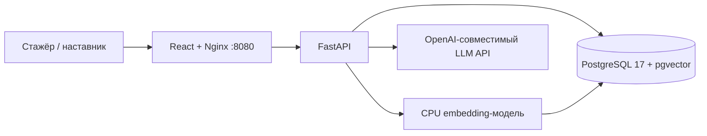

# AI-buddy — ИИ-наставник стажёра

Веб-приложение для адаптации стажёров: персональные планы, цели и задачи, согласование с наставником, проверка результатов и ИИ-чат с поиском по базе знаний. Прототип для «Авито Hack&Change 2026».

В приложении две роли — **стажёр** и **наставник**. Наставник работает только с закреплёнными стажёрами своей команды. Планы, переписки, результаты тестов и заявки сохраняются в PostgreSQL.

## Быстрый запуск

Нужны Git, Docker Engine с запущенным daemon и Docker Compose v2. Python и Node.js на компьютере для этого способа не требуются. Команды выполняются из корня проекта.

```bash
git clone https://github.com/ilasaa/ai-buddy.git
cd ai-buddy
cp .env.example .env
```

Откройте `.env` и задайте собственные значения:

| Переменная | Что указать |
| --- | --- |
| `POSTGRES_PASSWORD` | Пароль новой локальной БД |
| `JWT_SECRET` | Случайный секрет от 32 символов; генерация: `openssl rand -hex 48` |
| `DEMO_PASSWORD` | Пароль демоаккаунтов от 12 символов |
| `LLM_API_KEY` | Собственный ключ провайдера для ИИ-чата; можно оставить пустым |
| `LLM_BASE_URL` | Адрес OpenAI-совместимого API; по умолчанию `https://api.deepseek.com` |
| `LLM_MODEL` | Идентификатор модели, доступной вашему ключу; уточните у провайдера |

В `.env.example` нет рабочих ключей, токенов или паролей. `.env` исключён из Git. Не добавляйте секреты в исходники, скриншоты и переменные `VITE_*`: ключ LLM должен оставаться на backend.

Для локального HTTP оставьте `COOKIE_SECURE=false` и исходный `ALLOWED_ORIGINS`. `POSTGRES_HOST=127.0.0.1` нужен при запуске backend без контейнера; Compose автоматически заменяет его на `db`.

```bash
docker compose up --build -d
docker compose ps
docker compose logs --tail=100 -f backend
```

Если Docker требует административных прав, используйте `sudo docker compose …`. Выход из просмотра логов — `Ctrl+C`, контейнеры продолжат работать.

**Откройте [http://localhost:8080](http://localhost:8080).** Первый запуск требует интернета: скачиваются зависимости и CPU-модель `intfloat/multilingual-e5-small`, затем индексируется база знаний. Это может занять несколько минут. Frontend запускается после готовности backend.

Backend автоматически применяет миграции Alembic, создаёт демоданные и индексирует инструкции. Данные БД хранятся в volume `postgres_data`, модель — в `embedding_cache`. Повторный запуск не сбрасывает прогресс и не меняет пароли существующих пользователей.

## Вход и демонстрация

Пароль всех **вновь созданных** аккаунтов — ваш `DEMO_PASSWORD` из `.env`.

| Логин | Назначение |
| --- | --- |
| `mentor@ai-buddy.example` | Создание планов, проверка задач, ответы стажёрам и согласование заявок |
| `intern-new@ai-buddy.example` | Полный сценарий с нуля: стажёр без готового плана |
| `intern-ready@ai-buddy.example` | Обзор подготовленного плана, целей и задач в разных состояниях |
| `intern@ai-buddy.example` | Базовый профиль стажёра |

Все аккаунты, инструкции и примеры синтетические. При обновлении старой БД пароли сохраняются; старые аккаунты `manager` становятся наставниками, новые такие аккаунты не создаются.

1. Войдите наставником, выберите нового стажёра, создайте план с целями и задачами и отправьте на согласование.
2. В другом браузерном профиле войдите `intern-new`, откройте «Моя адаптация» и согласуйте план.
3. Начните задачу. Завершите её самостоятельно, пройдите мини-тест или отправьте результат наставнику — в зависимости от способа проверки.
4. Создайте черновик заявки на доступ и явно подтвердите отправку. Наставник увидит заявку и сможет принять решение.
5. Проверьте результат наставником: прогресс должен обновиться и сохраниться после перезагрузки.
6. При подключённом ключе спросите ассистента о своём плане или инструкции из базы знаний.

Подробный сценарий: [docs/demo-scenario.md](docs/demo-scenario.md).

## Возможности и ограничения

- Персональные планы, версии и согласование ожиданий, цели с критериями, командные OKR, сроки и прогресс.
- Задачи с самостоятельным подтверждением, проверкой наставника, серверным мини-тестом или условием отправки заявки. История попыток и замечаний сохраняется.
- Обращения к наставнику и обзор задач на проверке, блокировок, просрочек и заявок.
- ИИ-чат с историей, актуальными данными пользователя и RAG по синтетическим инструкциям; ответы могут содержать источники.
- Демонстрационные заявки Jira, Confluence и GitLab: черновик → подтверждение → решение наставника. Реальные сервисы не подключены; согласование **не выдаёт доступ**. Только задача с условием «Отправка заявки» завершается при создании связанной заявки.
- Светлая и тёмная темы.

Без ключа LLM планы, задачи и заявки работают; чат сообщает о необходимости настройки. Провайдер должен поддерживать Chat Completions и function Tool Calling. Приоритет ключей: `LLM_API_KEY` → `DEEPSEEK_API_KEY`; моделей: `LLM_MODEL` → `DEEPSEEK_MODEL`. Поддержка произвольного провайдера не гарантируется.

ИИ не утверждает план и не принимает кадровые решения. Достижение цели подтверждает наставник отдельно от завершения задач. Продуктовый эффект прототипа пока не измерен.

## Архитектура



Frontend: React 19, TypeScript, Vite, React Router, TanStack Query. Backend: Python 3.14, FastAPI, SQLAlchemy, Alembic, Pydantic Settings. Авторизация — JWT в HttpOnly cookie; изменяющие запросы проверяют Origin и специальный заголовок. Nginx проксирует `/api/*` в backend. Отдельный порт backend наружу не публикуется. Порты БД и веб-интерфейса привязаны к loopback компьютера.

```text
backend/app/          API, модели, прикладные сервисы
backend/alembic/      миграции БД
backend/scripts/      seed, индексация, проверки RAG
backend/knowledge/    синтетические инструкции и вопросы оценки
backend/tests/        тесты backend
frontend/src/         интерфейс и компонентные тесты
docs/                 сценарии, спецификации и отчёты
compose.yaml          запуск всего приложения
```

## Повседневные команды

```bash
# Обновить приложение, сохранив данные
git pull --ff-only
docker compose up --build -d

# Состояние и логи
docker compose ps
docker compose logs --tail=100 backend frontend db

# Проверить API через Nginx: ожидается {"status":"ok"}
curl --fail http://localhost:8080/api/health

# Остановить, сохранив данные
docker compose down
```

Существующий `.env` при обновлении не заменяйте: добавляйте только недостающие переменные. Изменение `POSTGRES_PASSWORD` в файле не меняет пароль уже созданной роли PostgreSQL. Изменение `DEMO_PASSWORD` не меняет существующие пароли пользователей.

### Вернуть исходное демосостояние

Команды ниже **удаляют весь текущий прогресс, планы, переписки и заявки**. Выполняйте только для демобазы, которую намеренно хотите сбросить. Кэш модели сохраняется.

```bash
# Сначала резервная копия; она содержит приватные данные, не добавляйте в Git
docker compose exec -T db sh -c 'pg_dump -U "$POSTGRES_USER" -d "$POSTGRES_DB" -Fc' > /tmp/ai-buddy-before-reset.dump

# Если резервное копирование успешно, очистить схему приложения
docker compose stop frontend backend
docker compose exec -T db sh -c 'psql -v ON_ERROR_STOP=1 -U "$POSTGRES_USER" -d "$POSTGRES_DB" -c "DROP SCHEMA public CASCADE; CREATE SCHEMA public;"'

# Миграции, seed и индексация выполнятся автоматически
docker compose up -d
docker compose logs --tail=100 -f backend
```

После сброса войдите с паролем `DEMO_PASSWORD`. При ошибке резервного копирования остановитесь до очистки. Для обычного обновления сброс не нужен. `docker compose down -v` удаляет постоянные данные и для обновления не требуется.

## Локальная разработка

Нужны Python 3.14, Node.js 24 с npm и PostgreSQL 17 с установленным pgvector. Заполните корневой `.env`. БД и пользователь должны существовать; пользователь должен иметь право создавать расширение `vector` либо администратор должен установить его заранее. Можно оставить БД в Docker: `docker compose up -d db`.

Backend, первый терминал (Bash):

```bash
cd backend
python3.14 -m venv .venv
.venv/bin/pip install --index-url https://download.pytorch.org/whl/cpu torch
.venv/bin/pip install -r requirements.txt
.venv/bin/alembic upgrade head
# Введите тот же собственный пароль, что в корневом .env; ввод скрыт
read -rsp 'DEMO_PASSWORD: ' DEMO_PASSWORD; echo
export DEMO_PASSWORD
.venv/bin/python -m scripts.seed_demo
unset DEMO_PASSWORD
.venv/bin/python -m scripts.preload_embeddings
.venv/bin/python -m scripts.index_knowledge
.venv/bin/uvicorn app.main:app --host 127.0.0.1 --port 8000
```

Seed читает `DEMO_PASSWORD` из окружения процесса, остальные настройки читаются из корневого `.env`.

Frontend, второй терминал:

```bash
cd frontend
npm ci
npm run dev
```

Откройте [http://localhost:5173](http://localhost:5173). Vite проксирует `/api` на `127.0.0.1:8000`. При смене порта API задайте `AI_BUDDY_API_TARGET` для Vite; при смене адреса интерфейса обновите `ALLOWED_ORIGINS`.

## Проверки

Тесты backend используют отдельную БД `ai_buddy_test`. В `.env` оставьте имя основной БД; скрипт миграций тестов выбирает тестовую сам. Создайте её тем же пользователем, например при БД в Docker:

```bash
docker compose exec db sh -c 'createdb -U "$POSTGRES_USER" ai_buddy_test'
cd backend
.venv/bin/python -m scripts.migrate_test
.venv/bin/python -m pytest
# Дополнительно: реальная CPU-модель, без платного LLM API
RUN_LOCAL_MODEL_TEST=1 .venv/bin/python -m pytest
.venv/bin/ruff check app scripts tests
```

```bash
cd frontend
npm ci
npm run build
npm run coverage
```

Проверено 15.11.2026: **112 backend-тестов** (96,52% строк), **60 frontend-тестов** (95,49% строк), TypeScript/Vite build и Ruff. На свежей отдельной PostgreSQL 18.6 + pgvector проверены миграции, повторный seed, индексация и HTTP-сценарии обеих ролей. На локальной PostgreSQL 17.11 проверены восстановление демобазы с нуля и работающий сервис через Nginx. Новая Docker-сборка в этом окружении недоступна. Подробности — [docs/verification-release.md](docs/verification-release.md). Автотесты используют mock LLM; платные запросы не выполняются.

После изменения инструкций запустите `python -m scripts.index_knowledge` и `python -m scripts.evaluate_rag` из `backend` с активным окружением. При изменении корпуса или модели заново подберите `RAG_MIN_SCORE`. Доступные параметры перечислены в [.env.example](.env.example).

## Если не запускается

| Симптом | Что проверить |
| --- | --- |
| `permission denied` для Docker | Запущен ли Docker, разрешён ли доступ пользователю; при необходимости используйте `sudo` |
| Backend долго запускается | Логи и интернет к PyPI, CPU-репозиторию PyTorch и Hugging Face; первый запуск скачивает модель |
| Секрет или пароль не задан | Заполните `.env`: `JWT_SECRET` от 32 символов, `DEMO_PASSWORD` от 12 |
| Порт 5432 или 8080 занят | Освободите порт либо измените левую часть привязки в Compose; при смене веб-порта обновите `ALLOWED_ORIGINS` |
| `502` / backend unhealthy | Посмотрите логи backend и db; дождитесь миграций и индексации |
| Вход не проходит после смены пароля в `.env` | Seed сохраняет прежний пароль; используйте его либо намеренно восстановите демосостояние |
| Ошибка Origin / cookie | Открывайте адрес из `ALLOWED_ORIGINS`; для HTTP — `COOKIE_SECURE=false`, для HTTPS — `true` |
| Чат недоступен | Проверьте серверный ключ, баланс, адрес и доступную модель; планы и задачи работают без ключа |

Дополнительно: [сценарий](docs/demo-scenario.md), [спецификации](docs/specs/README.md), [оценка RAG](docs/rag-evaluation-iteration4.md), [метрики](docs/metrics.md). Отчёты предыдущих итераций описывают состояние на дату их написания.
