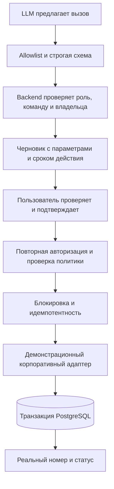

# Личный контекст и интеграционные инструменты

Участники: пользователь, LLM, backend, PostgreSQL, демонстрационный корпоративный адаптер. Предусловия: действующая сессия; инструменты получают пользователя из авторизации backend, а не аргументов LLM.

Реестр `app/services/tools.py` содержит allowlist имени, назначения и Pydantic-схемы аргументов. OpenAI function definitions строятся из него. Диспетчер выполняет проверки и вызывает существующие прикладные сервисы. Роли и подтверждения обеспечены сервисами, а не метаданными промпта. Полноценный MCP-сервер и универсальная схема результатов пока не добавлены; текущие обработчики можно в будущем обернуть MCP-адаптером без обхода прав.

| Инструмент | Данные / эффект | Права и подтверждение |
| --- | --- | --- |
| `get_my_adaptation_plan` | Текущий план и состояние | Только собственный стажёрский контекст |
| `get_my_goals` | Цели и критерии | Только собственный контекст |
| `get_my_onboarding_tasks` | Текущие задачи | Только собственные задачи |
| `get_my_progress` | Подтверждённые состояния | Только собственный контекст |
| `get_next_steps` | Детерминированные рекомендации | Только собственный контекст |
| `get_my_team_objectives` | Доступные OKR своей команды | Только собственный контекст |
| `create_access_request` | Подготовка черновика, заявка ещё не создана | Активный стажёр, разрешённая демополитика; выполнение — отдельная кнопка |
| `get_access_request_status` | Актуальный статус по ID | Видимость записи проверяет backend |
| `list_my_access_requests` | Свои заявки | ID пользователя из сессии |

Для MVP инструменты плана возвращают общий персональный контекст, а не разные копии моделей. Ни один инструмент не выполняет произвольный SQL, утверждение целей или кадровое решение. Дополнительные поля аргументов запрещены. За ответ разрешено до четырёх вызовов и не более одного черновика заявки. Тексты документов, переписка, результаты и названия задач недоверенны: они не могут менять роль backend или разрешения.

Личный контекст формируется перед каждым ответом чата из PostgreSQL. В него входят ожидания, версия и статус плана, цели, задачи, следующие шаги и OKR; предыдущая согласованная версия отмечается отдельно при наличии. Неактивный план нельзя представлять как согласованный. Полная история согласований и проверок не копируется в LLM-контекст. RAG используется для инструкций, а не как источник текущего статуса.

Ошибки: неизвестный инструмент → 400; неверные аргументы → объяснение/уточнение; чужая запись → 404; недоступная LLM → 503, тайм-аут → 504. Ответ о создании заявки появляется только после результата API подтверждения. Статусы инструментов отображаются непосредственно по данным backend, модель не генерирует номера.

Критерии успеха: запрос «Что от меня ожидает наставник?» использует сохранённые ожидания; отсутствие плана/OKR сообщается честно; чужие данные и prompt injection не расширяют разрешения; повторное подтверждение сохраняет один номер заявки.
