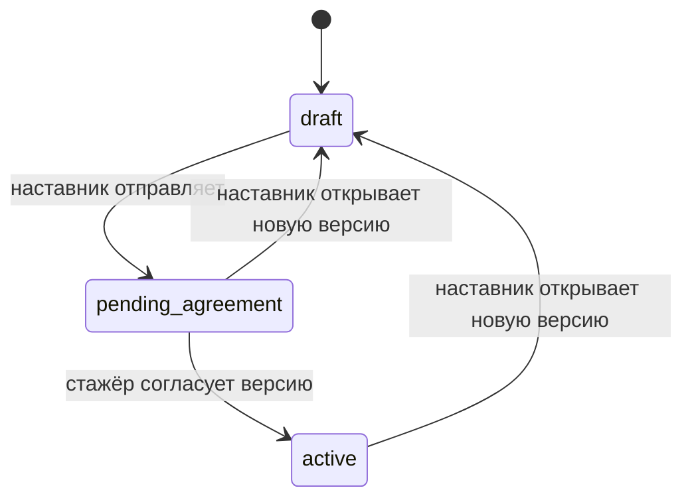
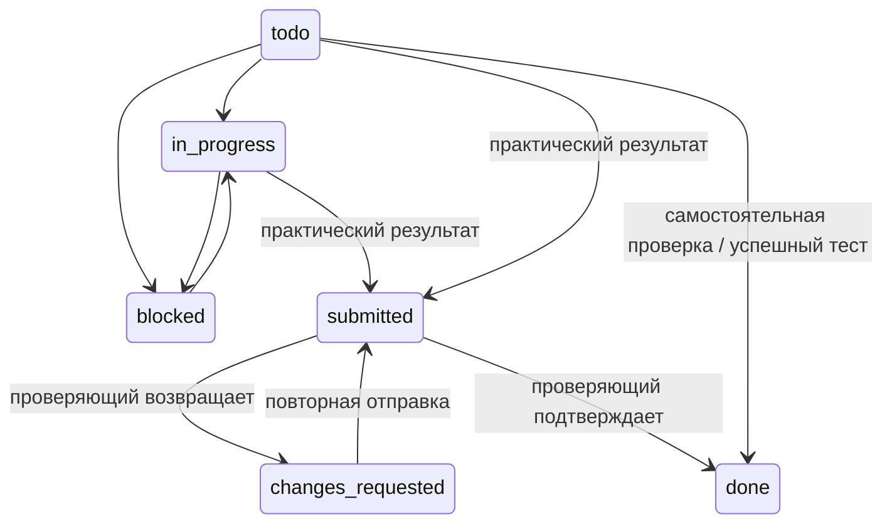
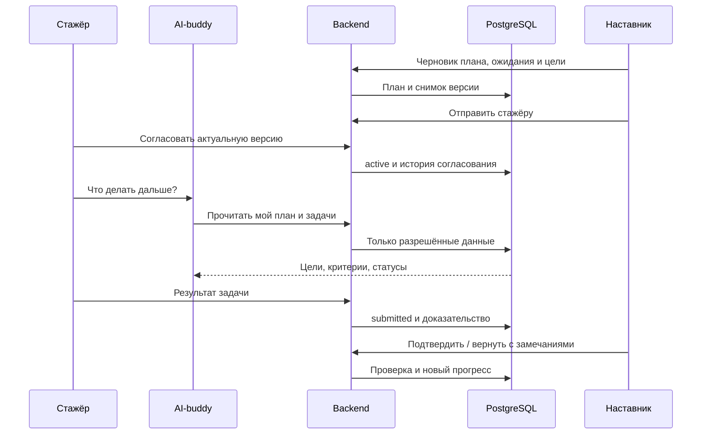

# Персональная адаптация: спецификация итерации 4

## Участники и границы прав

В приложении две роли: стажёр (`intern`) и наставник (`mentor`). Наставник той же команды, указанный в `intern.mentor_id`, определяет ожидания, управляет планом, целями и задачами, ведёт OKR, проверяет результаты и согласует заявки. Стажёр работает только со своими данными. Роль и принадлежность к команде не дают доступа к неназначенному стажёру. Недоступная запись — 404. Содержимое чужих диалогов не выдаётся: аналитика использует агрегаты. Полная актуальная схема — [две роли и действия](two-roles-and-task-actions.md).

## Сущности

`AdaptationPlan` хранит владельца-стажёра, автора-наставника, ожидания, даты, статус и номер версии. Один текущий план на стажёра. `AdaptationGoal` — результат, описание, критерии и срок; статус достижения подтверждается наставником с доказательством. `OnboardingTask` переиспользуется: задача относится к стажёру, может быть связана с целью, содержит способ проверки, проверяющего, результат и время проверки. `TeamObjective` содержит цель команды, период и массив текстовых ключевых результатов. Отдельная таблица числовых KeyResult для MVP не нужна.

`PlanAgreement` — неизменяемая история действий с автором, ролью, версией, комментарием, временем и JSON-снимком плана/целей/задач. `TaskVerification` — история отправок и решений; текущий результат также доступен на задаче. Снимок не является статической базой RAG.

## Создание и согласование

Предусловие: наставник назначен конкретному стажёру той же команды. Наставник открывает `/onboarding`, выбирает стажёра и сохраняет название, ожидания и период. Backend блокирует строку стажёра при первом создании, проверяет период и создаёт черновик. Добавление целей требует критериев и срока в периоде плана. Назначение задач проверяет принадлежность цели этому плану; перенос задачи к чужой цели запрещён. Способы проверки — `self`, `review`, `quiz`, `request`; для `quiz` обязателен существующий тест.

Наставник явно отправляет черновик стажёру; должен существовать хотя бы один результат с критериями. Стажёр оставляет комментарий, предлагает изменение текстом либо явно соглашается. Согласование сохраняет `agreed_at`, автора и снимок версии. Повторное согласование той же уже активной версии возвращает текущее состояние без второго события. ИИ не имеет инструмента утверждения плана.

`completed` и `archived` зарезервированы схемой, пользовательских переходов к ним пока нет. Процент задач не переводит план в `completed` автоматически.

## Изменение плана

Каждая запись черновика, добавление/редактирование цели или задачи увеличивает `version`. Все такие запросы требуют актуальный номер версии; устаревший запрос получает 409. После отправки или согласования нельзя редактировать ожидания и назначение задач напрямую: сначала наставник открывает новую версию. Предыдущий согласованный снимок остаётся в истории. Подтверждение критериев целей при пересмотре сбрасывается для новой версии; прошлое решение остаётся в снимке.

Изменение способа проверки существующей задачи возвращает её к `todo` и снимает текущее подтверждение, история сохраняется. Пока результат ожидает проверки, изменение определения задачи запрещено. Цель/задача редактируются без создания дублирующей сущности. Все записи используют PostgreSQL-транзакции и блокировки строк.

## Подтверждение задач

- `self`: стажёр меняет допустимый статус либо прикладывает результат. Выполнение фиксирует автора, время и запись истории. Стажёр может сообщить о блокировке.
- `review`: стажёр прикладывает непустой результат, отправляет его; задача становится `submitted`. Назначенный наставник либо наставник команды проверяет результат. Одобрение → `done` и время подтверждения. Возврат → `changes_requested`, обязателен комментарий. После исправлений стажёр повторяет отправку.
- `quiz`: только серверная проверка сохранённого ключа теста может перевести задачу в `done`; обычная отправка результата и PATCH со статусом `done` запрещены.

У `done` обязательно заполнен `completed_at`, у остальных статусов он отсутствует (ограничение БД). Стажёр не ставит `submitted`/`changes_requested` обычным PATCH. Результат на проверке нельзя снять произвольным статусом. Подтверждённую практическую задачу нельзя самостоятельно переоткрыть. Утверждённая цель защищена от самостоятельного изменения связанных задач.

## Достижение цели и прогресс

Процент = число задач `done` / число всех задач × 100, с округлением; пустой список = 0%. Это процент задач, не итоговая оценка стажировки. Подсчитываются ожидающие проверки, блокировки и просрочки; просрочена незавершённая задача с датой раньше текущей даты сервера. Рекомендации детерминированы: согласовать отсутствующий/неактивный план, обсудить блокировку, дождаться проверки, выполнить ближайшие незавершённые задачи, обсудить задачи для цели без действий.

Наставник отдельно подтверждает цель: план активен, есть связанные задачи, все завершены, приложено подтверждение критериев. ИИ и стажёр не могут объявить цель достигнутой этой операцией.

## Ошибки и критерии приёмки

401 — нет сессии; 403 — запрещённая роль/действие; 404 — отсутствующая или недоступная запись; 409 — устаревшая версия, неправильный переход, повторная отправка результата; 422 — неверные даты, пустые критерии/результат/замечания; 503 — недоступна БД. Форма показывает ошибку; при 409 пользователь обновляет данные и проверяет актуальную версию. Повторные изменения не должны молча переписывать согласованные ожидания.

Успех: после нового GET и повторного входа сохраняются план, цели, связи задач, согласование, доказательства и история. Интеграционные тесты используют отдельную PostgreSQL-базу и проверяют записи, а не только текст mock LLM.

